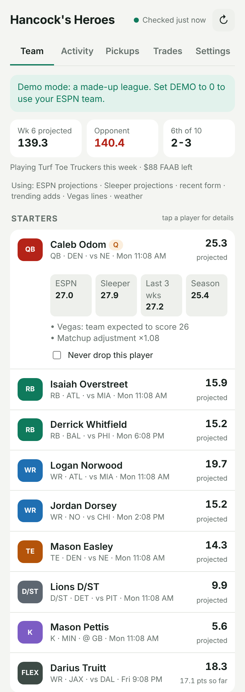

# ESPN Fantasy Autopilot

Runs your ESPN fantasy football team for you from a Docker container on a Synology NAS,
with a phone-friendly page to see what it's doing.

**Every 15 minutes it:**
- **Sets your lineup**: starts the best players, benches anyone out, on IR or on bye, and swaps in a
  late-game backup when someone is ruled out on Sunday morning. It never touches a player whose game
  has started, and keeps the latest-kickoff player in FLEX so late swaps stay possible.
- **Makes pickups**: fills a starting spot that would score zero (out, bye, empty), streams kicker and
  defense for much better matchups, and once a day (never right before games) picks up a clearly better
  free agent or places a waiver claim, dropping your weakest bench player. Capped at 2 pickups a week
  by default, and you can mark players **Never drop**.
- **Uses the IR spot** for players on injured reserve.
- **Suggests trades** where both lineups improve. It never sends offers.

**It doesn't just trust ESPN.** Each player's projection blends:

| Source | Used for |
|---|---|
| ESPN projections | baseline |
| Sleeper projections | a second independent projection (50/50 with ESPN; 30% for defenses) |
| Sleeper weekly results | recent form: last 3 weeks of actual scoring |
| Sleeper trending adds | what managers everywhere are picking up today (lowers the bar for upgrades a bit) |
| Vegas lines (ESPN's public NFL scoreboard) | teams expected to score more get up to +12%, low totals down to −12%; defenses vs. weak offenses get a boost |
| Open-Meteo weather | wind 15+ / 20+ mph, rain or snow at outdoor stadiums trims kickers and passing |

All free, no extra accounts. If any source is down the rest still work; the Team tab shows which were used.
Tap a player to see each source's number.

## Install on Synology (from a phone browser)

1. **Make the image public (one time).** After the first GitHub build finishes (Actions tab, ~3 min):
   GitHub → your profile → **Packages** → `espn-fantasy-bot` → **Package settings** →
   **Change visibility** → Public. The image contains no passwords; those live only on your NAS.
2. **Open DSM** on home Wi-Fi: `http://<NAS-IP>:5000`.
3. **Container Manager → Project → Create.**
   - Project name: `fantasy-bot`
   - Path: create `/docker/fantasy-bot`, and inside it (File Station) an empty folder named `data`.
   - Source: *Create docker-compose.yml*, paste [`docker-compose.yml`](docker-compose.yml).
   - Change `DASH_PASSWORD`. League and team IDs are already filled in.
4. **Next → Done**, then open `http://<NAS-IP>:18480` and sign in (any username + your password).
5. **Settings tab → ESPN login codes.** Follow the steps there once from a computer with Chrome
   (copy `espn_s2` and `SWID`), paste them in, Save. You can paste from your phone if you email/message
   them to yourself. They last about a year; you'll get an alert if they expire.

That's it. Check the **Activity** tab now and then, or set up phone alerts below.

### Updating
When the code changes, GitHub rebuilds the image. In Container Manager:
**Project → fantasy-bot → Action → Build**.

### Outside your home
Same as your other NAS services: DSM **Control Panel → Login Portal → Advanced → Reverse Proxy**
pointing a hostname at `localhost:18480`. Keep `DASH_PASSWORD` set; the page can change your team.

## Phone alerts (ntfy)
1. Install the **ntfy** app, tap **+**, subscribe to a long random topic name.
2. Put `NTFY_URL: "https://ntfy.sh/<that-name>"` in the compose file and Build.
3. Settings tab → **Send test**.

You get a push for each lineup change or pickup, a weekly trade idea (Tuesday morning), and problems
(ESPN codes expired, a move ESPN rejected).

## Settings (environment variables)

| Variable | Default | Meaning |
|---|---|---|
| `LEAGUE_ID`, `TEAM_ID` | — | From your team's URL (`leagueId=…&teamId=…`). |
| `SEASON` | this year | Season year. |
| `DASH_PASSWORD` | empty | Password for the page. Recommended. |
| `NTFY_URL` | empty | Phone alerts, see above. |
| `POLL_MINUTES` | `15` | How often to check ESPN (minimum 5). |
| `EXTRA_SOURCES` | `1` | `0` = ESPN projections only. |
| `DEMO` | `0` | `1` = fake league, for trying the page. |

Everything else (autopilot on/off, pickups per week, how to treat Questionable players, waiver bids)
is on the page's Settings tab.

## Good to know
- It uses ESPN's unofficial website API (the same calls the ESPN site makes). If ESPN changes it,
  a move may fail; you'll get an alert and the Activity tab will say so.
- Turn off **Make pickups** if you'd rather approve roster changes yourself; the bot will then push
  suggestions instead.
- Test locally without ESPN: `DEMO=1 DATA_DIR=./data python3 app/main.py`, and `python3 tests/test_demo.py`.
